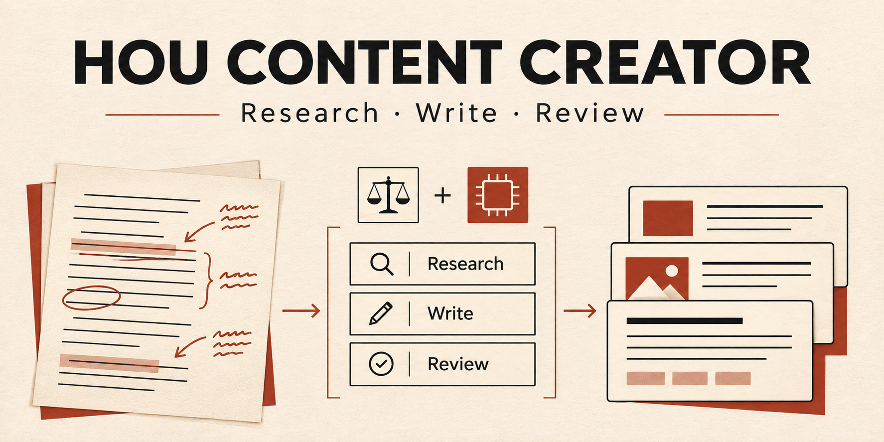
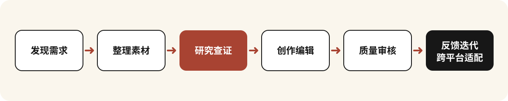

<p align="center">
  
</p>

# 侯同学·内容创作助手

**Hou Content Creator** 是一个可复用的中文内容创作 Agent Skill。它把创作者自己的观点、素材、经历、平台规范和审核标准，整理成一套可以持续改进的 AI 协作流程。

[](https://github.com/2224878257-pixel/hou-content-creator/releases)
[](https://github.com/2224878257-pixel/hou-content-creator/actions/workflows/validate.yml)
[](LICENSE)

[English](README_EN.md) · [安装](#安装) · [示例](examples/README.md) · [参与贡献](CONTRIBUTING.md)

> 人负责原创观点、研究、实践与素材；AI 负责辅助整理、编辑、润色、事实核查和质量审核。

## 它解决什么问题

通用 AI 很容易写出结构工整却没有个人判断的内容，也可能把计划写成成果、把推断写成事实，甚至补造经历和数据。本项目把“怎么写”之外的关键边界也做成可执行规则：保护原意、核实来源、识别隐私、适配平台，并在交付前诚实审核。

它不是爆款生成器，不会承诺流量，也不会代替创作者提供真实经历。

## 核心能力

- **保留创作者声音**：先识别原始观点、事实和表达意图，再进行编辑。
- **自然中文表达**：减少模板腔、空话、机械排比和过度营销。
- **事实与来源核查**：区分亲历、事实、观点、推断、计划和未知信息。
- **多平台适配**：支持公众号、知乎、小红书、短视频、B站、X 与朋友圈。
- **标题与视觉审核**：检查承诺是否兑现，提供克制的封面与配图规范。
- **三遍内部编辑**：依次检查事实与原意、自然表达、重复与空话，发现问题直接修复。
- **十项质量审核**：按适用项检查，不为凑分虚构证据。
- **隐私与合规**：处理客户、公司内部信息、身份数据和 AI 生成内容的真实性边界。

## 内容创作流程

<p align="center">
  
</p>

流程用于校验，不是强制文章结构。简单的标题修改可以只执行与标题相关的步骤。

## 支持场景

| 场景 | 典型任务 |
| --- | --- |
| 公众号 | 原稿润色、结构编辑、文章审核 |
| 短视频 / 播客 / B站 | 口播优化、分镜、字幕与来源提示 |
| 知乎 | 直接回答、证据补充、条件与反例 |
| 小红书 | 图文适配、卡片文案、封面文案 |
| X / 朋友圈 | 短内容重写、语气与长度适配 |
| 编辑工作 | 标题优化、事实核查、隐私检查、质量评分 |

## 安装

### 推荐：GitHub CLI 一条命令安装

需要 GitHub CLI `2.90.0` 或更高版本。`gh skill` 当前仍是公开预览功能，建议先预览源码：

```bash
gh skill preview 2224878257-pixel/hou-content-creator hou-content-creator
```

安装 v1.0.1 到用户级目录：

**Codex**

```bash
gh skill install 2224878257-pixel/hou-content-creator hou-content-creator@v1.0.1 --agent codex --scope user
```

**Claude Code**

```bash
gh skill install 2224878257-pixel/hou-content-creator hou-content-creator@v1.0.1 --agent claude-code --scope user
```

**Cursor**

```bash
gh skill install 2224878257-pixel/hou-content-creator hou-content-creator@v1.0.1 --agent cursor --scope user
```

命令会把技能安装到对应宿主识别的目录。安装后新建会话，再用下面的提示词调用。GitHub 官方说明见 [`gh skill install`](https://cli.github.com/manual/gh_skill_install)；该命令支持的其他宿主可通过 `gh skill install --help` 查看。

### ChatGPT

ChatGPT 的 Skills 目前面向符合条件的 Business、Enterprise、Healthcare 与 Edu 用户开放，并受工作区设置和产品可用性影响。进入 **Plugins → Skills**，使用 Skills 编辑器创建或上传技能；下载本项目的 Release 压缩包并选择其中完整的 `hou-content-creator` 技能目录。ChatGPT 当前没有官方文档确认可从任意 GitHub 仓库一条命令直接安装 Skill，因此本项目不提供未经核实的命令。

官方说明：[Skills in ChatGPT](https://help.openai.com/en/articles/20001066-skills-in-chatgpt)。

### Agent Plugin

仓库根目录包含符合 Agent Plugins 1.0.0 的 [`plugin.json`](plugin.json)，技能位于标准 `skills/` 目录，可供支持该标准的宿主进行本地导入和测试。OpenAI 的 ChatGPT 与 Codex 支持这种可移植插件结构；Cursor 也声明支持 Agent Plugins 标准。

本仓库尚未提交到任何公共插件目录。公开发布需要额外审核，不应把“本地可导入”理解为“商店已上架”。

### 手动安装

下载 Release 中的 `hou-content-creator-v1.0.1.zip`，解压后将完整的 `hou-content-creator/` 文件夹复制到宿主的技能目录。常见目录包括：

| 宿主 | 项目级 | 用户级 |
| --- | --- | --- |
| Codex / 通用 Agent Skills | `.agents/skills/` | `~/.agents/skills/` |
| Claude Code | `.claude/skills/` | `~/.claude/skills/` |
| Cursor | `.cursor/skills/` 或 `.agents/skills/` | `~/.cursor/skills/` 或 `~/.agents/skills/` |

宿主版本可能改变目录和同步方式，请以 [Agent Skills 规范](https://agentskills.io/specification)、[Cursor Skills 文档](https://cursor.com/docs/skills)和对应产品当前文档为准。

## 快速使用

```text
使用 $hou-content-creator，把下面的真实素材整理成一篇公众号文章。保留我的判断，不要补造经历或数据。
```

```text
使用 $hou-content-creator，把这篇文章改成一分钟口播稿。只做平台适配，不改变事实和结论。
```

```text
使用 $hou-content-creator，只审核这篇内容。列出待核实事实、隐私风险和十项质量评分，不要重写全文。
```

不同宿主的显式调用语法可能是 `$hou-content-creator`、`/hou-content-creator` 或直接在提示词中提到技能名称。

## 实际示例

[`examples/`](examples/README.md) 包含七组完整示例：公众号润色、短视频口播、知乎、小红书、X/朋友圈、标题优化和质量审核。每组都包含原始素材、用户指令、示例输出与审核结果，并明确使用虚构教学素材，不冒充真实效果数据。

## 十项质量标准

1. 选题价值
2. 标题准确度
3. 封面表达（任务不含封面时记为不适用）
4. 开头留存
5. 证据与真实性
6. 独特判断
7. 可读与共鸣
8. 信息密度
9. 读者收益
10. 品牌一致性

完整说明和评分方法见 [`quality-review.md`](skills/hou-content-creator/references/quality-review.md)。评分只用于编辑判断，不预测平台表现。

## 自定义写作风格

编辑 [`writing-style.md`](skills/hou-content-creator/references/writing-style.md) 开头的品牌资料：

- 品牌名称与身份边界
- 关注主题与目标读者
- 常用语气与禁用表达
- 已公开且可验证的案例

再按需要调整 [`platform-rules.md`](skills/hou-content-creator/references/platform-rules.md) 和 [`cover-style.md`](skills/hou-content-creator/references/cover-style.md)。不要把示例或默认品牌经历复制成自己的经历。

## 项目结构

```text
hou-content-creator/
├── plugin.json                     # Agent Plugins 可移植清单
├── skills/hou-content-creator/     # 可独立安装的 Skill
│   ├── SKILL.md
│   ├── agents/openai.yaml
│   ├── assets/icon.svg
│   └── references/
├── examples/                       # 七组已复核教学示例
├── docs/images/                    # 封面与流程图
├── scripts/                        # 校验与打包工具
├── tests/                          # 行为测试记录
└── .github/                        # Issue 模板与自动化工作流
```

## 常见问题

**它会自动发布内容吗？**

不会。技能默认只生成和审核素材，不登录账号、不群发，也不执行发布。

**它会联网核查所有事实吗？**

取决于宿主是否提供联网工具。不能联网时，技能会标出未验证内容，而不是假装已核实。

**可以保证去除所有“AI 味”或做出爆款吗？**

不能。它通过真实素材、个人判断和编辑规则减少模板化表达，但不承诺流量、收益或检测器结果。

**能否用于英文内容？**

当前规则围绕中文内容设计。可以处理简单英文请求，但尚未对英文平台风格做系统验证。

**为什么封面项有时不计分？**

只做文字时，封面不属于交付范围。按适用项计算比假装封面已完成更诚实。

## 路线图

- 收集更多经授权、可公开的匿名测试案例
- 增加可选的品牌配置模板与迁移指南
- 验证更多支持 Agent Skills / Agent Plugins 的宿主
- 根据平台官方规则更新合规参考
- 在用户确认后评估公共插件目录提交

路线图不代表已实现功能。进展以 [Issues](https://github.com/2224878257-pixel/hou-content-creator/issues) 与 [Releases](https://github.com/2224878257-pixel/hou-content-creator/releases) 为准。

## 贡献与安全

欢迎提交问题和改进，先阅读 [CONTRIBUTING.md](CONTRIBUTING.md)。隐私或安全问题请按 [SECURITY.md](SECURITY.md) 私下报告。版本变化见 [CHANGELOG.md](CHANGELOG.md)。

## 许可证

本项目采用 [MIT License](LICENSE)。许可证允许使用、修改和分发代码与文档，但不额外授予第三方内容、商标、平台素材或示例中未拥有的权利。
