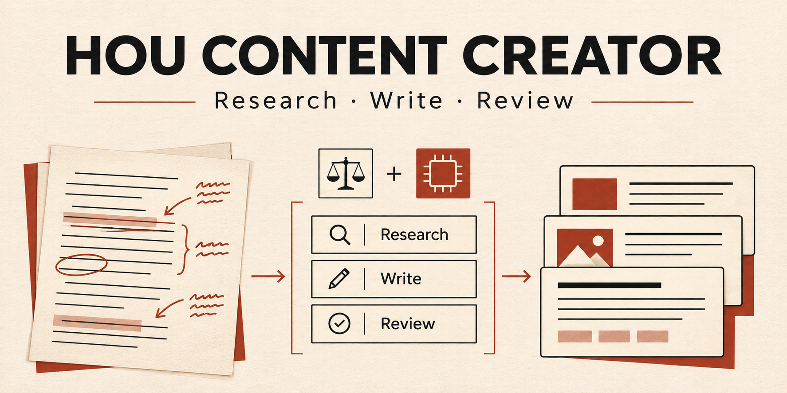
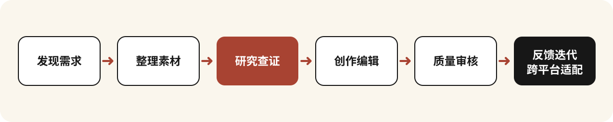

<p align="center">
  
</p>

# Hou Content Creator

**Hou Content Creator** is a reusable Agent Skill for Chinese content creation. It turns a creator's own ideas, evidence, voice, platform preferences, and review standards into an AI-assisted workflow that can improve over time.

[](https://github.com/2224878257-pixel/hou-content-creator/releases)
[](https://github.com/2224878257-pixel/hou-content-creator/actions/workflows/validate.yml)
[](LICENSE)

[中文](README.md) · [Examples](examples/README.md) · [Contributing](CONTRIBUTING.md)

> Humans provide original ideas, research, experience, and source material. AI helps organize, edit, verify, adapt, and review.

## Why this project exists

Generic AI writing often sounds polished but impersonal. It may blur the line between a plan and a result, present inference as fact, or invent experience and numbers. This skill adds explicit safeguards for intent, evidence, privacy, platform adaptation, and honest quality review.

It is not a viral-content generator and does not promise traffic or revenue.

## Core capabilities

- Preserve the creator's intent, voice, and evidence boundaries
- Edit natural Chinese without rigid templates or empty marketing language
- Separate firsthand experience, facts, opinion, inference, plans, and unknowns
- Adapt content for WeChat, Zhihu, Xiaohongshu, short video, Bilibili, X, and Moments
- Review titles, cover direction, privacy, authenticity, and platform fit
- Apply seven conversational writing guidelines and check originality, media authenticity, copyright, AI labeling, and platform requirements
- Open with concrete details, revise against prior feedback, and use evidence to structure Bilibili knowledge videos
- Run three silent editing passes for factual fidelity, natural language, and removal of repetition or filler
- Apply a ten-part quality review without fabricating evidence to improve a score

## Workflow

<p align="center">
  
</p>

The workflow is a review path, not a mandatory article template.

## Installation

### GitHub CLI (recommended)

GitHub CLI `2.90.0` or later is required. The `gh skill` command is currently in public preview.

Preview before installing:

```bash
gh skill preview 2224878257-pixel/hou-content-creator hou-content-creator
```

Install v1.3.0 at user scope:

```bash
# Codex
gh skill install 2224878257-pixel/hou-content-creator hou-content-creator@v1.3.0 --agent codex --scope user

# Claude Code
gh skill install 2224878257-pixel/hou-content-creator hou-content-creator@v1.3.0 --agent claude-code --scope user

# Cursor
gh skill install 2224878257-pixel/hou-content-creator hou-content-creator@v1.3.0 --agent cursor --scope user
```

See the official [`gh skill install` documentation](https://cli.github.com/manual/gh_skill_install).

### ChatGPT

ChatGPT Skills are currently available to eligible Business, Enterprise, Healthcare, and Edu users, subject to workspace settings and product availability. Open **Plugins → Skills** and use the Skills editor to create or upload a skill. Download the Release archive and select the complete `hou-content-creator` skill folder. There is no documented one-command installation from an arbitrary GitHub repository, so this project does not claim one.

Official reference: [Skills in ChatGPT](https://help.openai.com/en/articles/20001066-skills-in-chatgpt).

### Agent Plugin and manual installation

The root [`plugin.json`](plugin.json) follows Agent Plugins 1.0.0, with the standalone skill under `skills/`. It can be imported locally by compatible hosts; the plugin has **not** been submitted to a public directory.

For manual installation, download `hou-content-creator-v1.3.0.zip` from Releases and copy the included skill folder to the host's project-level or user-level skills directory. Refer to the [Agent Skills specification](https://agentskills.io/specification) and current host documentation.

## Quick start

```text
Use $hou-content-creator to turn the following real source material into a WeChat article in Chinese. Preserve my judgment and do not invent experience or data.
```

```text
Use $hou-content-creator to audit this draft only. List unverified claims, privacy risks, and the ten-part quality review without rewriting it.
```

Explicit invocation may use `$hou-content-creator`, `/hou-content-creator`, or the skill name, depending on the host.

## Examples and quality standard

The [`examples/`](examples/README.md) directory contains seven reviewed teaching examples with source material, user prompts, outputs, and audit results. All scenarios are fictional and make no performance claims.

The ten review dimensions are topic value, title accuracy, cover clarity when applicable, opening retention, evidence and authenticity, original judgment, readability and resonance, information density, reader value, and brand consistency. Full rules are in [`quality-review.md`](skills/hou-content-creator/references/quality-review.md).

## Customize the voice

Edit the brand profile at the top of [`writing-style.md`](skills/hou-content-creator/references/writing-style.md): identity, audience, themes, tone, prohibited phrases, and verified public examples. Adjust platform and visual rules only when needed. Never copy a teaching example or the default author's experience as your own.

## Limitations

- Web verification depends on tools provided by the host.
- The project does not publish content or access social accounts.
- It cannot guarantee virality, revenue, or AI-detector results.
- The current rules are designed and tested primarily for Chinese content.

## Contributing, security, and license

Read [CONTRIBUTING.md](CONTRIBUTING.md) before opening a change. Report sensitive issues through [SECURITY.md](SECURITY.md). Changes are documented in [CHANGELOG.md](CHANGELOG.md).

Licensed under the [MIT License](LICENSE).
